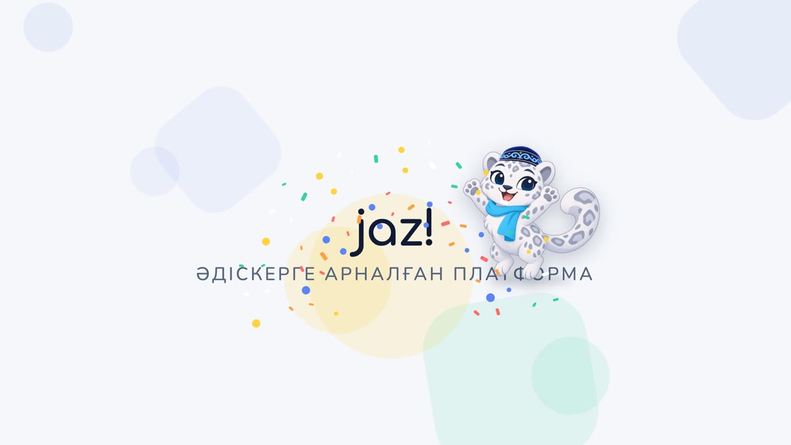
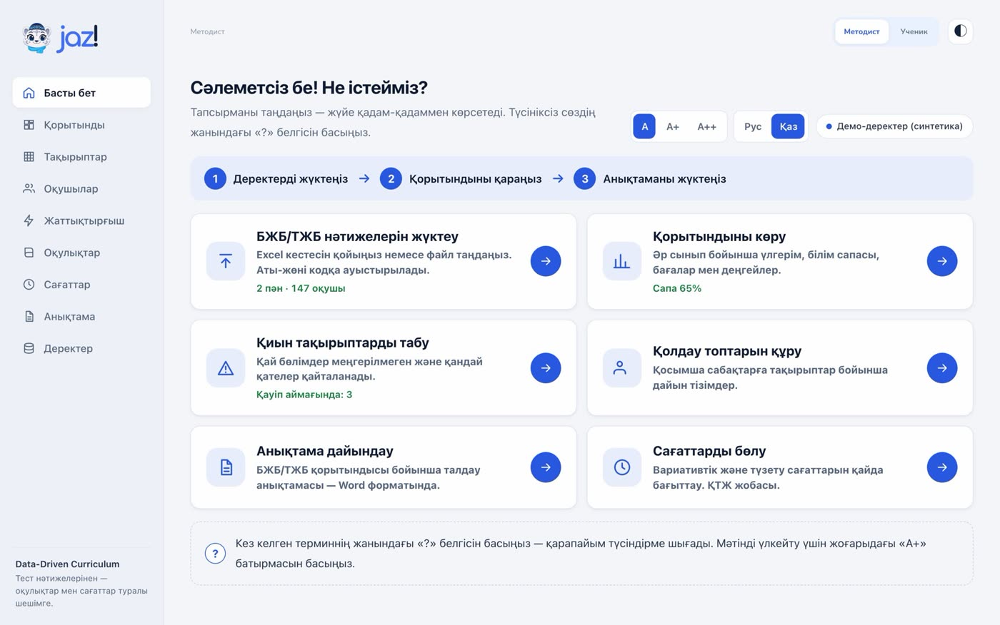
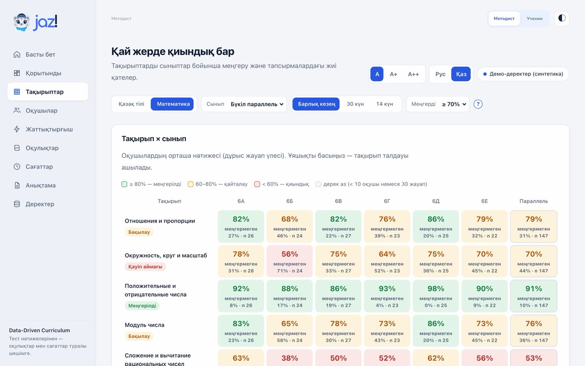
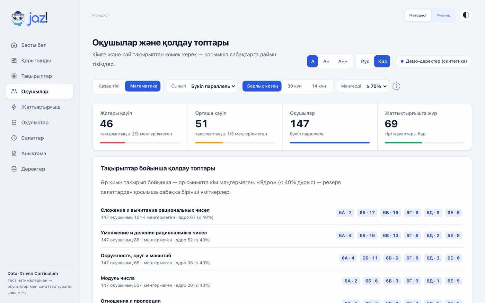
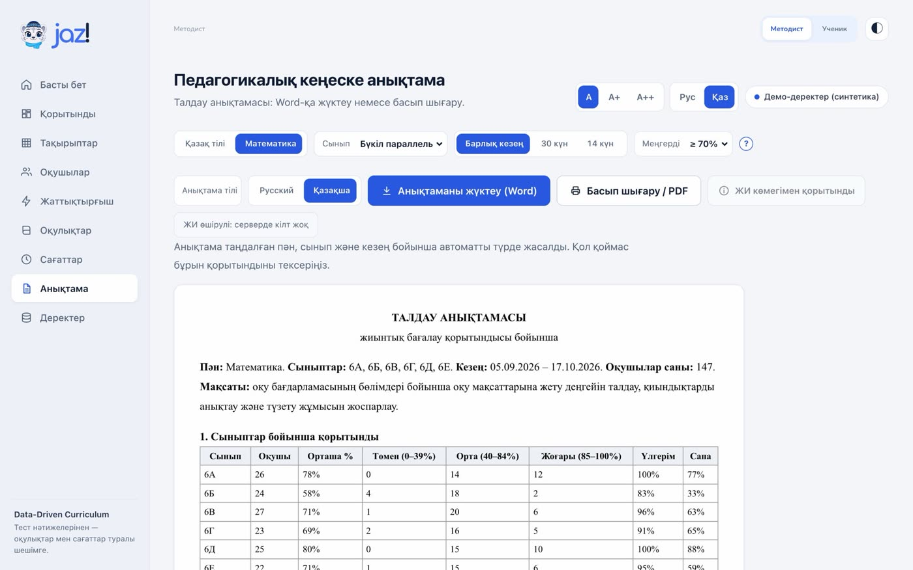
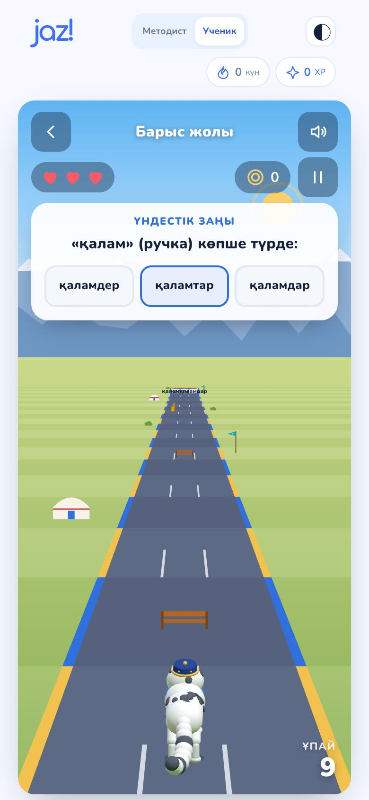
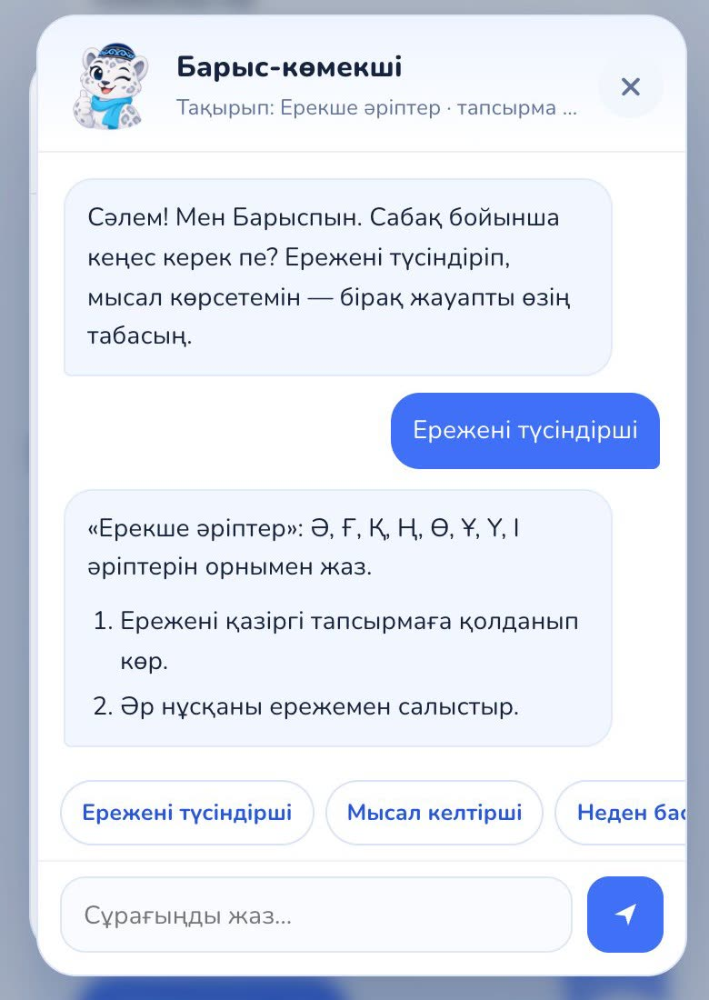

# Jaz! - платформа для школьного методиста

**Кейс 1 «Data-Driven Curriculum».** Методист загружает результаты БЖБ/ТЖБ (СОР/СОЧ) и за минуты видит, какие темы и классы проседают, кому нужна помощь, как перераспределить часы, и получает готовую аналитическую справку на казахском или русском языке. Ученики добирают слабые темы в тренажёре с игрой, а методист видит их рост отдельно от официальных оценок. Подходит для любого предмета: аналитика не зависит от содержания.

| | Ссылка | QR |
|---|---|---|
| 🎬 **Промо-видео (35 с)** | **https://youtu.be/wE2EH2xU6ZE** |  |
| 🌐 **Рабочий сайт** | **https://jaz-kazakh-learning.vercel.app** |  |
| 💻 **Код (этот репозиторий)** | https://github.com/shadix23/jaz-kazakh-learning |  |
| 📊 **Презентация (қазақша)** | [PDF](docs/pitch/Jaz-pitch.pdf) · [PPTX](docs/pitch/Jaz-pitch.pptx) | |

[](https://youtu.be/wE2EH2xU6ZE)

## Проверить за 2 минуты

Регистрация не нужна, в продукте уже загружены демо-данные (синтетическая школа: 6 классов, 147 учеников, подписано в интерфейсе). Язык переключается кнопкой **Қаз / Рус** вверху.

1. Откройте **https://jaz-kazakh-learning.vercel.app**, режим **Әдіскер (Методист)**. Главная страница: шесть задач методиста на одном экране.
2. **Тақырыптар / Темы**: тепловая карта «тема × класс». Красные клетки - зоны риска (≥ 40% учеников не освоили тему).
3. **Оқушылар / Ученики**: готовые группы поддержки по каждой трудной теме и классу.
4. **Сағаттар / Часы**: перераспределение учебных часов «было → стало» с обоснованием.
5. **Анықтама / Отчёт**: аналитическая справка по итогам БЖБ/ТЖБ, скачивается в Word.
6. Переключитесь в режим **Оқушы (Ученик)**: игра «Барыс жолы» (бег по полосе с правильным ответом) и помощник Барыс, который подсказывает, но не даёт готовый ответ.

## Какую проблему решаем

После каждого БЖБ/ТЖБ методист вручную сводит таблицы по классам, ищет слабые темы, составляет списки на дополнительные занятия и пишет справку для педсовета. Это часы работы каждую четверть, и выводы часто остаются на уровне «средний балл упал». Jaz! превращает таблицу результатов в конкретные решения: какую тему, в каком классе, с какими учениками и за счёт каких часов подтянуть. Подробнее: [исследование работы методиста](docs/METHODIST-RESEARCH.md), [разбор кейса](docs/CASE-ANALYSIS.md), [соответствие критериям](docs/CRITERIA-CHECK.md).

## Скриншоты

| Главная методиста | Тема × класс |
|---|---|
|  |  |
| **Группы поддержки** | **Справка для педсовета** |
|  |  |

| Игра «Барыс жолы» | Помощник Барыс |
|---|---|
|  |  |

## Что умеет: требования кейса → где в продукте

| Требование кейса | Где в продукте |
|---|---|
| Загрузка реальных результатов | **Данные**: вставка таблицы СОР/СОЧ из Excel или файл (русские/казахские заголовки, ФИО → коды), входной балл необязателен |
| Привычные школьные показатели | **Обзор**: успеваемость, качество знаний, оценки 5/4/3/2, уровни низкий/средний/высокий по классам |
| Анализ результатов по темам | **Темы**: тепловая карта «тема × класс», разбор каждой темы: результат, доля не освоивших, прирост, сравнение классов |
| Выявление сложных разделов | Статус темы (зона риска ≥ 40% не освоивших), анализ заданий: трудность, различающая способность, типичные неверные ответы |
| Сравнение учебников | **Учебники**: матрица «учитель × учебник», разница прироста с учётом учителя и 95% интервалом, общая и по каждой теме; блокировка вывода, если учитель и учебник смешаны, с подсказкой, какой класс перевести |
| Рекомендации по часам | **Часы**: программа (редактируется) + резерв + перенос с освоенных тем → «было → стало» с обоснованием по каждой теме, экспорт CSV |
| Связь ученика и методиста | **Тренажёр**: коды классов (6 цифр), вход ученика по коду с любого устройства, задания группам поддержки, прогресс «СОР до → тренажёр начало → сейчас» |
| Рост отдельно от СОР/СОЧ | Тренажёр - формирующие данные: не входят в успеваемость и справку; рост считается внутри тренажёра (первые попытки против последних, 95% интервал) и показывается рядом с СОР/СОЧ |
| Кому нужна помощь | **Ученики**: уровни риска, готовые группы поддержки по темам и классам («өзек/ядро» - ≤ 40% верных), профиль ученика, экспорт списков |
| Справка | **Отчёт**: аналитическая справка по итогам СОР/СОЧ на русском или казахском, скачивание в Word |
| Простота для любого возраста | **Главная** «Что нужно сделать?», размер текста A/A+/A++, «?» с объяснением каждого термина, язык Рус/Қаз |
| Решение для руководства | **Обзор** (KPI, решения для педсовета, живые данные из тренажёра) и **Отчёт** на одну страницу для печати/PDF; при ключе API - выводы, сформулированные ИИ по сводным цифрам (без кодов учеников) |

## Методика кратко

* Тема освоена учеником при ≥ 70% верных (порог 60/70/80 меняется). «Мало данных»: меньше 10 учеников или 30 ответов.
* Сравнение учебников: прирост = результат − входная диагностика; модель `прирост ~ учебник + учитель (+ тема)`; 95% ДИ - бутстрэп учеников внутри классов. «Больше/меньше прирост» - только если ДИ не включает 0 и разница ≥ 5 п.п. Формулировка - связь, а не причина.
* Часы: потребность = доля не освоивших × часы темы × важность (1-3); распределяются резерв и до 20% часов тем, которые освоили ≥ 85% учеников; не больше +50% к теме; целые часы методом наибольших остатков. Сумма часов сохраняется.

## Запуск локально

```bash
npm install     # единственная зависимость - @anthropic-ai/sdk (ИИ на сервере, необязательно)
npm start       # сайт + API: http://127.0.0.1:4174
npm test        # 78 автотестов: аналитика, интерфейс, i18n, сквозной сценарий API
```

Без сборки: чистые HTML/CSS/JS в `dist/`, сервер на Node без фреймворков в `server/`. Без ключей ИИ всё работает на правилах. Развёртывание на Vercel с Upstash Redis: [DEPLOY.md](DEPLOY.md).

## Как устроено

```
dist/        фронтенд: кабинет методиста (metodist.*), тренажёр ученика (app.js, game.js, barys3d.js),
             помощник Барыс (assistant.js), переключение языка (i18n.js)
server/      API: пространство школы, коды классов, вход ученика, ответы, задания, ИИ-прокси
api/         Vercel-функция (тот же обработчик, что и в dev-server.cjs)
tests/       автотесты (node --test)
docs/        питч, исследование, разбор кейса, технические детали, QR-коды, скриншоты
```

Приватность: только псевдонимные коды учеников, ФИО при импорте превращаются в коды; в ИИ уходят только сводные цифры. Технические детали (дизайн-система, API, формат данных, тренажёр): [docs/TECH.md](docs/TECH.md).

## Команда

* **Shadil Nurmukhammed** - founder
* **Amangeldiev Kaisar** - co-founder

## Материалы защиты

Презентация: [PDF](docs/pitch/Jaz-pitch.pdf) · [PPTX](docs/pitch/Jaz-pitch.pptx) (12 слайдов, корректно открываются в Canva). Сценарий и источники цифр: [docs/PITCH.md](docs/PITCH.md), спич на двоих: [docs/PITCH-SPEECH.md](docs/PITCH-SPEECH.md).
